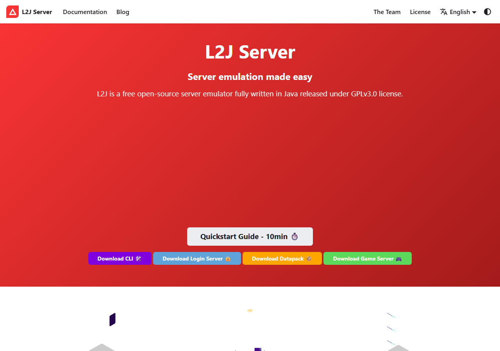
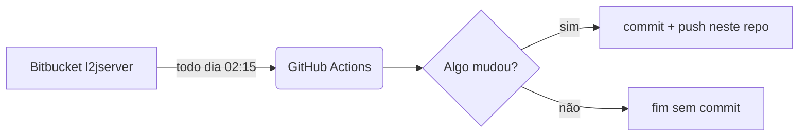

# L2J Server — oficial (espelho automático)



> **L2J** é o emulador de servidor de Lineage II oficial, livre e open-source, escrito em **Java**
> e distribuído sob **GPLv3**. Este repositório é um **espelho diário** do código oficial
> (que vive no **Bitbucket**, não no GitHub).


---

## Por que um espelho?

O repositório `github.com/L2J` está **abandonado** (último commit em 2019) e o próprio projeto
avisa para usar o Bitbucket. O site oficial (`l2jserver.com`) também está fora do ar desde
novembro/2026 — o DNS aponta para `8.8.8.8`.

Então este repositório junta, todo dia às **02:15 (Brasília)**, o que está ativo no Bitbucket.

## O que tem aqui

| Pasta | Repositório oficial | O que é |
|---|---|---|
| [`game/`](game) | [l2j-server-game](https://bitbucket.org/l2jserver/l2j-server-game) | Core do servidor (game server), em Java |
| [`datapack/`](datapack) | [l2j-server-datapack](https://bitbucket.org/l2jserver/l2j-server-datapack) | NPCs, quests, scripts e dados do mundo |
| [`login/`](login) | [l2j-server-login](https://bitbucket.org/l2jserver/l2j-server-login) | Login server (autenticação das contas) |
| [`commons/`](commons) | [l2j-server-commons](https://bitbucket.org/l2jserver/l2j-server-commons) | Biblioteca comum do game e do login |

O L2J é dividido em **Game Server** (Core + Datapack) e **Login Server**.
O **Core** é o Java com a mecânica do jogo; o **Datapack** são diálogos, scripts de missão, AIs, etc.

---

## Guia de instalação (o oficial, em português)


> Texto recuperado do site oficial pelo arquivo da internet:
> <https://web.archive.org/web/20260313053957/https://www.l2jserver.com/pt/docs/installation-guide>
> Versão completa em texto: [`docs/INSTALACAO-PT.md`](docs/INSTALACAO-PT.md)

### 1. Software necessário

- Sistema operacional atualizado
- **Java (JDK)** — o L2J acompanha a última LTS
- **MariaDB** (recomendado) ou MySQL 8.0+
- **Git**
- (opcional) HeidiSQL ou DBeaver para ver o banco

```powershell
winget install EclipseAdoptium.Temurin.25.JDK
winget install -e --id Git.Git
winget install -e --id MariaDB.Server

java --version
git --version
```

Crie o usuário do banco:

```sql
CREATE OR REPLACE USER 'l2j'@'%' IDENTIFIED BY 'l2jserver2019';
GRANT ALL PRIVILEGES ON *.* TO 'l2j'@'%' IDENTIFIED BY 'l2jserver2019';
FLUSH PRIVILEGES;
```

> Mudou a senha? Edite `config/server.properties` do **game** e do **login**.

### 2. Código fonte

```powershell
mkdir C:\opt\l2j\git
cd C:\opt\l2j\git

git clone -b master  https://bitbucket.org/l2jserver/l2j-server-login.git
git clone -b develop https://bitbucket.org/l2jserver/l2j-server-game.git
git clone -b develop https://bitbucket.org/l2jserver/l2j-server-datapack.git
```

> `develop` = versão mais recente (High Five) · `master` = estável.
> Também existem os ramos Interlude, Epilogue, Freya…

### 3. Compilar (Maven)

```powershell
cd C:\opt\l2j\git\l2j-server-login
.\mvnw install

cd C:\opt\l2j\git\l2j-server-game
.\mvnw install

cd C:\opt\l2j\git\l2j-server-datapack
.\mvnw install
```

> Para o build não arrastar, pegue uma **NVD API Key** grátis
> (<https://nvd.nist.gov/developers/request-an-api-key>) e defina a variável `NVD_API_KEY`.

### 4. Implantar (descompactar)

```powershell
mkdir C:\opt\l2j\server\login
cd C:\opt\l2j\server\login
tar -xf C:\opt\l2j\git\l2j-server-login\target\l2j-server-login-*.zip

mkdir C:\opt\l2j\server\game
cd C:\opt\l2j\server\game
tar -xf C:\opt\l2j\git\l2j-server-game\target\l2j-server-game-*.zip
tar -xf C:\opt\l2j\git\l2j-server-datapack\target\l2j-server-datapack-*.zip
```

> Os nomes dos `.zip` mudam a cada versão.

### 5. Banco de dados (L2J CLI)

```powershell
mkdir C:\opt\l2j\cli
cd C:\opt\l2j\cli
curl -o l2jcli.zip -L https://l2jserver.com/api/download/cli/latest   # site oficial está fora do ar
tar -xf l2jcli.zip
```

> Alternativa ao download: compilar o `l2j-server-cli` do Bitbucket.

Edite `login-server.properties` e `game-server.properties` (`DatabaseUser` / `DatabasePassword`) e rode:

```powershell
l2jcli.bat
db install -sql C:\opt\l2j\server\login\sql -u l2j -p l2jserver2019 -m FULL -t LOGIN -c -mods
db install -sql C:\opt\l2j\server\game\sql  -u l2j -p l2jserver2019 -m FULL -t GAME  -c -mods
```

| Parâmetro | Para que serve |
|---|---|
| `-sql` | pasta dos arquivos SQL |
| `-u` / `-p` | usuário e senha do banco |
| `-m` | `FULL` (do zero) ou `UPDATE` |
| `-t` | `LOGIN` ou `GAME` |
| `-c` | instalar tabelas personalizadas |
| `-mods` | instalar tabelas de mods |

Conta de administrador (nível **8** = master):

```
account create -u SeuNome -p -a 8
quit
```

### 6. Portas (só se for jogar de fora)

```powershell
netsh advfirewall firewall add rule name="L2J Login Server" dir=in action=allow protocol=TCP localport=2106
netsh advfirewall firewall add rule name="L2J Game Server"  dir=in action=allow protocol=TCP localport=7777
```

> Precisa de prompt **como administrador**.

### 7. Geodata

<https://bitbucket.org/l2jgeo/l2j_geodata/get/master.zip>

### 8. Iniciar

```powershell
C:\opt\l2j\server\login\startLoginServer.bat
C:\opt\l2j\server\game\startGameServer.bat
```

### 9. Conectar

No `C:\Windows\System32\drivers\etc\hosts`:

```
127.0.0.1 l2authd.lineage2.com
```

Ou um `.bat`:

```bat
@start l2.bin IP=127.0.0.1
```

> ⚠️ Modificação no cliente **não é permitida** no L2J (GameGuard, L2.ini).

---

## Como o sync funciona



- Workflow: [`.github/workflows/sync.yml`](.github/workflows/sync.yml)
- Manual: aba **Actions → sync L2J oficial → Run workflow**

## Licença

O L2J é distribuído sob **GPLv3** — este espelho mantém a licença e os créditos originais
(`LICENSE`, cabeçalhos e autores de cada projeto).

## Fontes

- Bitbucket oficial: <https://bitbucket.org/l2jserver>
- Site do projeto (fora do ar): <https://www.l2jserver.com> — espelho do guia no
  [arquivo da internet](https://web.archive.org/web/20260313053957/https://www.l2jserver.com/pt/docs/installation-guide)
- Geodata: <https://bitbucket.org/l2jgeo>
